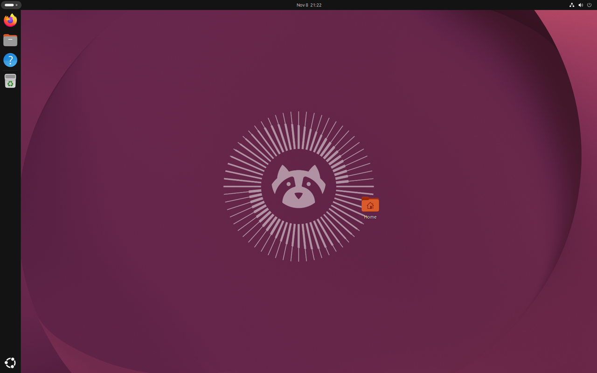

<h1>
  <picture>
    <source media="(prefers-color-scheme: dark)" srcset="assets/logo-dark.svg">
    
  </picture>
</h1>

A command-line tool for named macOS, Linux and Windows VMs on Apple Silicon Macs,
built on Apple's Virtualization framework.
The full guide is at [hobo.gsquared.app](https://hobo.gsquared.app/).

```sh
hobo init                          # write a starter Hobo.toml
hobo validate                      # check it without building
hobo create dev                    # build a VM from ./Hobo.toml
hobo list
hobo start dev                     # headless under launchd; never steals focus
hobo ssh dev
hobo stop dev                      # clean shutdown; --force powers off
```

## Requirements

- Apple Silicon Mac, macOS 27+
- Xcode 27 (Swift 6.4+)
- `brew install lld go`, to build: the Windows boot driver and the guest agent are compiled from source during the build
- To run Windows guests, a Windows on Arm ISO from [Microsoft](https://www.microsoft.com/en-us/software-download/windows11arm64). Read the caveats in [Guest operating systems](https://hobo.gsquared.app/guests/#windows) first

## Install

```sh
make install                 # release build, ad-hoc signed: /usr/local/bin/hobo and /usr/local/share/hobo
```

## Features

<!-- features:start -->

<!-- Generated by `make readme` from docs/features/*.md: edit those, not this. -->

### Recipes

A recipe is a TOML file, conventionally `Hobo.toml`, that says what a VM is built from and how
it's set up. `hobo init` writes a starter that's already pinned to an exact macOS build or Ubuntu
release, and `hobo validate` checks a recipe without building anything. Every VM gets the same
conventions (user `hobo`, password `hobo`, passwordless sudo, SSH); `[[provision]]` steps add
the rest.

```sh
hobo images                        # macOS builds this Mac can run
hobo init 26B123                   # a Hobo.toml pinned to that build
hobo validate
```

Full guide → [hobo.gsquared.app/recipes](https://hobo.gsquared.app/recipes/)

### Guest operating systems

Hobo runs macOS, Ubuntu Linux and Windows 11 on Arm guests, all on Apple's Virtualization
framework, all built from a recipe and used through the same commands. macOS installs unattended
from Apple's IPSW, Linux from Ubuntu's cloud images, and Windows from a Microsoft ISO without ever
showing Setup.

```sh
hobo init --os linux && hobo create ubuntu
hobo exec ubuntu -- uname -a
```

Full guide → [hobo.gsquared.app/guests](https://hobo.gsquared.app/guests/)

### Running VMs

VMs have names, and `hobo list` shows them all with their state and disk use. `hobo start` boots
a VM in the background under launchd and returns once SSH answers: it's headless and never takes
focus, so it can run all day without getting in your way. `hobo view` opens a window onto it when
you want one.

```console
$ hobo start ubuntu
Starting ubuntu
  waiting for a DHCP lease
  waiting for SSH on 192.168.64.6
ubuntu is running (192.168.64.6)

$ hobo list
NAME     STATE    ADDRESS       OS                     CPUS  MEMORY  DISK (USED/SIZE)  SNAPSHOTS
mac      stopped                macOS 27.2.0 (26B123)  4     8 GB    29.59 GB / 80 GB  —
ubuntu   running  192.168.64.6  Ubuntu 26.04           4     4 GB    6.26 GB / 32 GB   —
```

Full guide → [hobo.gsquared.app/running-vms](https://hobo.gsquared.app/running-vms/)

### Getting inside

`hobo ssh` logs in, `hobo exec` runs a command and exits with its status, and `hobo cp` copies
files either way. There are no keys or IP addresses to look up: hobo knows each VM's address and
logs in with hobo's own well-known key. Host folders can be shared into the guest, read-only if you like.

```console
$ hobo exec dev -- uname -a
Linux dev 7.0.0-38-generic #38-Ubuntu SMP PREEMPT_DYNAMIC Fri Sep  4 09:28:02 UTC 2026 aarch64 GNU/Linux

$ hobo cp ./notes.txt dev:/tmp/
$ hobo ssh dev
```

Full guide → [hobo.gsquared.app/getting-inside](https://hobo.gsquared.app/getting-inside/)

### Shared clipboard

While a VM's window shows, its clipboard and the Mac's are one: copy text on the Mac and paste it
in the guest, or copy in the guest and paste on the Mac. There's nothing to install or turn on.

```sh
hobo view dev     # copy and paste both ways while this window shows
```

Full guide → [hobo.gsquared.app/clipboard](https://hobo.gsquared.app/clipboard/)

### Suspend and resume

`hobo suspend` saves a running VM's memory and device state to disk and stops it. `hobo start`
resumes it in a few seconds, with every app and shell where you left them and the guest's clock set
to the host's. Nothing is lost by accident: throwing the saved state away is always a separate,
explicit step.

```console
$ hobo suspend dev
  saving state
Suspended dev (608 MB saved state)

$ hobo start dev
Resuming dev
  resuming
  setting the guest's clock
dev resumed (192.168.64.6)
```

Full guide → [hobo.gsquared.app/suspend-resume](https://hobo.gsquared.app/suspend-resume/)

### Snapshots

`hobo snapshot save` keeps a VM's state under a tag. A running VM pauses for a moment and carries
on, and its snapshot includes its memory, so restoring returns to that running moment with every app
still open. Snapshots are APFS clones, so they cost only the blocks that change afterwards.

```console
$ hobo snapshot save dev clean
Saved snapshot clean of dev (with 512 MB of saved state)

$ hobo exec dev -- sh -c 'rm -rf ~/important'      # oops

$ hobo snapshot restore dev clean --force
  forcing the VM off
Restored dev to clean
Resuming dev
  resuming
dev is running at 192.168.64.6
```

Full guide → [hobo.gsquared.app/snapshots](https://hobo.gsquared.app/snapshots/)

### Clones and ephemeral VMs

`hobo clone` copies a stopped VM instantly, since APFS shares the disk blocks until either VM
changes them, and the copy can run beside the original. `hobo start --ephemeral` goes one step
further: it boots a throwaway clone that deletes itself when it stops, or after half an hour
idle. Build a VM once, then try anything in a fresh copy.

```console
$ hobo start dev --ephemeral
Cloned dev to dev-6b62
Starting dev-6b62
  waiting for a DHCP lease
  waiting for SSH on 192.168.64.6
dev-6b62 is running (192.168.64.6); deleted after 30m idle

$ hobo stop dev-6b62
  shutting down over SSH
Stopped and deleted dev-6b62, which was ephemeral
```

Full guide → [hobo.gsquared.app/clones](https://hobo.gsquared.app/clones/)

### Changing a VM

A recipe gives a VM its starting size; `hobo set` changes it afterwards: CPUs, memory, disk size
and shared folders. The disk grows in place, and the guest's filesystem grows into the new space on
its next boot. `hobo provision` runs a recipe's steps again on a running VM, to try them out or to
bring an older VM up to date.

```console
$ hobo set dev --cpus 6 --memory 8GB --disk 120GB
Growing the disk image to 120GB
dev: 6 CPUs, 8 GB memory, 120 GB disk
The guest grows into the larger disk at the next hobo start dev.
```

Full guide → [hobo.gsquared.app/changing-a-vm](https://hobo.gsquared.app/changing-a-vm/)

### Screenshots and GUI testing

`hobo screenshot` saves a PNG of a guest's desktop, and `hobo exec --gui` runs a command in the
guest's desktop session, so UI tests run inside a clean VM over SSH. Nothing on the host takes
focus, and no window needs to be open: a headless VM keeps its display at full size.

```console
$ hobo screenshot ubuntu
/Users/me/ubuntu-20261108-162240.png
```



Full guide → [hobo.gsquared.app/gui-testing](https://hobo.gsquared.app/gui-testing/)

### Agents

Hobo is built for coding agents as well as people. `hobo claude install` gives Claude Code a skill
for testing in clean VMs, every command takes `--json`, and `hobo usage` prints the whole reference
in one read. An agent can start a throwaway VM, build and test inside it, screenshot the desktop, and
leave nothing behind, all without touching the host's screen.

```sh
hobo claude install     # the hobo skill, in ~/.claude/skills/hobo
```

Full guide → [hobo.gsquared.app/agents](https://hobo.gsquared.app/agents/)

<!-- features:end -->

## Build from source

```sh
make install                 # release build, ad-hoc signed: /usr/local/bin/hobo and /usr/local/share/hobo
HOBO_SIGN_IDENTITY="Developer ID Application: …" make install
make sign                    # stage and sign .build/hobo (bin/hobo, share/hobo) without installing it
PREFIX=~/.local make install # install somewhere else
make test                    # README check, then unit tests
make integration-test        # tests that drive the signed binary
HOBO_WINDOWS_ISO=<path> make integration-test   # also build and test a Windows guest from that ISO
make readme                  # regenerate the README's features from docs/features
```

The design record is [docs/design.md](docs/design.md).

## License

Apache-2.0
