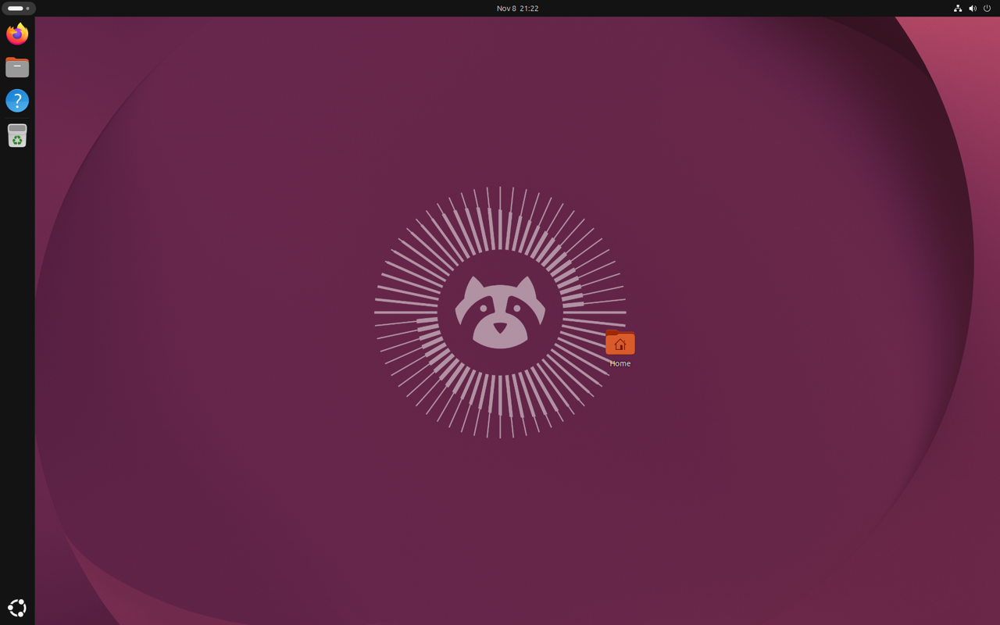

`hobo screenshot` saves a PNG of a guest's desktop, and `hobo exec --gui` runs a command in the
guest's desktop session, so UI tests run inside a clean VM over SSH. Nothing on the host takes
focus, and no window needs to be open: a headless VM keeps its display at full size.

```console
$ hobo screenshot ubuntu
/Users/me/ubuntu-20261108-162240.png
```



<!-- more -->

## Screenshots

```sh
hobo screenshot dev                 # a new dev-<timestamp>.png here
hobo screenshot dev shot.png        # that file, replacing it (or -o shot.png)
hobo screenshot dev - | open -f -a Preview
hobo screenshot dev --app TextEdit   # only that app's windows
hobo screenshot dev --ref e12        # only that element, by its ref from hobo ui snapshot
hobo screenshot dev --crop 840,412,400,300    # only that rectangle: x,y,width,height
```

`--app` keeps an app's windows: the rectangle around all of them, when it has several. `--ref`
keeps one element, a window or anything in one, by the ref [`hobo ui snapshot`](#drive-an-app-with-hobo-ui)
gave it; the ref is the frontmost app's unless `--app` names another. Both ask `hobo ui` where it
is, so they work where `hobo ui` does.

`--crop` keeps one rectangle of the screen, in screenshot pixels from the top left. It also takes a
frame the way [`hobo ui snapshot`](#drive-an-app-with-hobo-ui) prints one, so an element's or a window's frame
can be pasted in: `--crop "840,412 400×300"`. A rectangle that reaches past the screen keeps the
part that's on it.

The capture runs inside the guest's desktop session, which each guest needs:

| Guest | Needs |
| --- | --- |
| macOS | A VM built from a recipe with `[gui_testing]` |
| Linux | A desktop: `hobo init --os linux` adds one; `--server` leaves it out |
| Windows | Nothing more: `hobo` is logged in at boot |

## Run in the desktop session

```sh
hobo exec dev --gui -- open -a TextEdit
hobo exec dev --gui -- osascript -e 'tell application "System Events" to keystroke "hello"'
```

A plain `hobo exec` runs in a background session that can't see the desktop. `--gui` runs the
command in `hobo`'s desktop session instead, waiting up to a minute for it to come up, and exits
with status 125 if it never does.

On macOS, a privacy prompt raised by what `--gui` runs (Photos, Automation and the like) names
`hobo-agent` as the app asking, not the command: macOS holds the agent responsible for what it
starts, so the prompt can't show the program's own usage text, and what the prompt
grants goes to `hobo-agent`.

## Drive an app with hobo ui

`hobo ui` drives a macOS, Linux or Windows guest's apps through accessibility, from the host, with
nothing to install in the guest (a macOS guest needs macOS 27; `exec --gui` and `screenshot` work on
older ones). `snapshot` prints an app's windows as a tree, each element with a ref to act
on:

```console
$ hobo exec dev -- open -a TextEdit
$ hobo ui dev wait --app TextEdit
TextEdit is running with a window
$ hobo ui dev snapshot --app TextEdit
app TextEdit (com.apple.TextEdit) pid 628
- window "Untitled" [e1] (213,86 586×488)
  - scrollarea [e2] (213,154 586×420)
    - textbox [e3] #First Text View (213,186 586×382) focused
  - group "Formatting" [e22] (213,118 586×36)
    - checkbox "bold" [e23] (221,127 22×20) unchecked
    …
$ hobo ui dev type "Hello" --into e3 --app TextEdit
$ hobo ui dev menu "Format > Font > Bold" --app TextEdit
$ hobo ui dev wait --text "Hello" --app TextEdit
```

A Linux guest takes the same commands, against GNOME's apps:

```console
$ hobo exec ubuntu --gui -- gnome-text-editor
$ hobo ui ubuntu type "Hello" --app org.gnome.TextEditor
$ hobo ui ubuntu key ctrl+shift+s --app org.gnome.TextEditor
$ hobo ui ubuntu choose ~/Documents/hello.txt --app org.gnome.TextEditor
```

And a Windows guest, against its apps:

```console
$ hobo exec win --gui -- powershell.exe -Command 'Start-Process notepad'
$ hobo ui win type "Hello" --app notepad
$ hobo ui win menu "File > Save as" --app notepad
$ hobo ui win choose 'C:\Users\hobo\Documents\hello.txt' --app notepad
```

| Command | Does |
| --- | --- |
| `snapshot` | Prints the tree, open context menus and their submenus included. `--all` adds offscreen elements and long lists in full, `--root e12` one subtree, `--depth N` fewer levels. `--role textbox` lists just the elements of that role, offscreen ones included, without the tree |
| `at <x,y>` | What's at a point read off a screenshot: the element there and the elements it's in, with refs, in whichever app it is, and a menu open elsewhere that a click there would close |
| `click <ref\|x,y>` | A real click at the element's centre once windows over it stop animating in or out, failing if something covers it, and warning when a menu open elsewhere likely swallowed it. `--text Remove` clicks the one element showing exactly that text, `--contains` matches part of it instead, `--role menuitem` narrows it, and `--in e30` looks only inside that element (the list, not an inspector showing the same name). `--right`, `--double`, `--mods cmd,shift`; `--press` performs the element's default action instead |
| `drag <from> <to>` | A real drag, pausing over the target before it drops |
| `scroll <ref\|x,y> <direction> [lines]` | Scroll wheel events; `scroll --to e40` brings an element into view |
| `type <text> [--into ref]` | Types text where the cursor is, whatever the keyboard layout. `--replace` selects all first, so the text replaces what the field had |
| `key <cmd+k>` | Presses a key with modifiers. Keys are named as typed or by name: `cmd+-` or `cmd+minus`, `cmd++` or `cmd+plus`, `return`, `escape`, `left`, `f5`. It prints what had the focus, which is what the key went to: `pressed escape with the focus on textbox "Search" [e7] …` |
| `menu "File > Save"` | Chooses a menu item, failing if it's disabled; `menu File` lists the items with their shortcuts. Titles are as the open menu shows them, such as `Undo Typing`. A macOS app's menu bar is `menu`'s alone: `snapshot` and `click --text` leave it out |
| `choose <path>` | Chooses a file or folder in the open or save panel an app is showing: waits up to 5 seconds for the panel, so it can follow the click that opens it, goes to the path, then clicks Open or Save. On Linux it uses the file chooser's location bar, including GNOME's save dialog, which runs in Files' process; on Windows the dialog's File name box |
| `wait` | Waits for `--ref`, `--text` (which matches part of an element's text, as `click --text --contains` does, and `--role button` narrows) or `--app`, or with `--gone` for it to go. On a timeout it prints the snapshot, and a `--gone` wait names the element still there: a hidden view can still be an accessibility element |

- **Refs** keep their numbers across snapshots while the element is there, so `e12` from an earlier
  snapshot still means the same thing. One that has gone fails as stale rather than clicking
  whatever took its place. Give the controls of an app you're testing accessibility identifiers
  (the `#saveButton` after a ref), and its refs survive layout changes.
- **A snapshot line** is the element's role, `"name"`, `[ref]`, `#identifier`, `= "value"`,
  `(x,y width×height)` and its states (`disabled`, `focused`, `selected`, `checked` or
  `unchecked`), in that order and leaving out what the element hasn't got:
  `textbox "Name" [e14] #nameField = "Untitled" (420,180 240×22) focused`. To find an element
  from a script, ask for it (`snapshot --role textbox`, `click --text`, `wait --text`) rather
  than match lines of the whole tree.
- **Roles** are ARIA role names (`button`, `textbox`, `menuitem`, `checkbox`), plus `window`,
  `text` and `scrollarea`, so `--role` means the same in every guest; `--json` also gives the
  platform's own role (`AXTextArea`). A text field is a `textbox` and a pop-up button a `combobox`;
  a `--role` nothing has fails listing the roles that are there.
- **Coordinates** are screenshot pixels, the same as in a `hobo screenshot` PNG.
- **Failures** are also recorded on the host, in `~/.hobo/ui-failures.log`: each `hobo ui` command
  that failed, with its exit status and what it printed, the newest last. A script's check that
  throws a command's output away (`hobo ui dev wait … >/dev/null 2>&1`) can still be explained
  afterwards, even once an ephemeral VM is gone. The file keeps about the last megabyte.
- `--app` takes an app ID (a bundle ID such as `com.apple.TextEdit`, a desktop app ID such as
  `org.gnome.TextEditor`, a Windows AUMID or exe name such as `notepad`), a name or `pid:<n>`;
  without it, the frontmost app. File Explorer's folder windows and its shell are both `explorer`,
  so give the window's `pid:<n>`.
- **Shortcuts** are the guest's own: `cmd+s` on macOS, `ctrl+s` on Linux and Windows.
- `--json` prints any command's result as JSON, failures included.
- Each call takes about a third of a second. A macOS VM needs `[gui_testing]`; a Linux desktop VM
  is set up for it by its recipe's desktop step, and a Windows VM needs nothing.
- GTK 4 lists build rows only for what's on screen, so in a Linux snapshot a long list's rows come
  and go as it scrolls.
- To launch an app with environment variables or arguments, use `hobo exec dev -- open -n --env
  KEY=value /Applications/App.app --args …`.

## Driving the UI yourself

- **macOS:** `[gui_testing]` in the recipe grants Accessibility, Screen Recording and System Events
  automation to hobo's guest agent, `osascript`, `screencapture` and Terminal, so `hobo ui`,
  AppleScript and XCUITest work with SIP still on. `allow` adds your own test runners by path or
  bundle ID:

  ```toml
  [gui_testing]
  enabled = true
  allow   = ["com.example.AppUITests.xctrunner"]
  ```

  A VM built this way, and its clones, show `"guiTesting": true` in their config in `hobo list --json`.

- **Linux:** the desktop has accessibility on for AT-SPI, with the Python bindings installed, and
  the `hobo` user can send input through `/dev/uinput`, which `hobo ui` uses.
- **Windows:** UI Automation, which `hobo ui` uses, and from `powershell.exe` in the desktop session.

## Test in a clean copy every time

Build a VM once with everything your tests need, then run each test in an
[ephemeral clone](./clones.md) that deletes itself afterwards:

```sh
vm=$(hobo start ui-base --ephemeral --json | jq -r 'select(.event=="result").result.name')
hobo cp ./build "$vm":/tmp/
hobo exec "$vm" --gui -- /tmp/build/run-ui-tests
hobo screenshot "$vm" failure.png
hobo stop "$vm"
```
